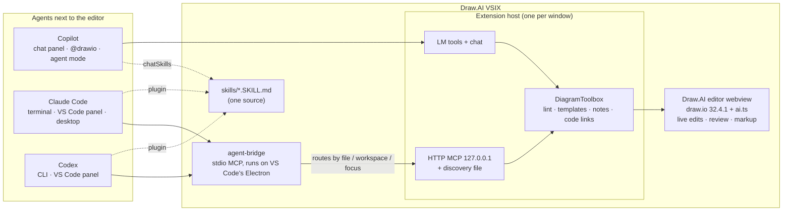

# Bringing PrixmaViz into Draw.AI: proposal

Status: **M1 (items 1–3) is built** in this worktree and not committed; see
[M1 as built](#m1-as-built). The rest is a proposal. Feasibility spikes live in
[`spikes/headless-host/`](../spikes/headless-host/), and their results are in [section 5](#5-spike-results).

Goal, in Michael's words: *"have skills, plugins, connectors, and mods in not just Visual Studio
but also Claude Code. That lets us do some of these really, really advanced things that I do
with PrixmaViz, all in one big product."*

**Ground rule for this proposal: Draw.AI is a VS Code extension, and it stays the product.**
Claude Code and Codex are agents the user runs *next to* the diagram, in VS Code's terminal, in
their own VS Code panels, or in a separate terminal or desktop app. Draw.AI should make those
agents first-class users of the editor the person already has open. It should not become a
second, separate product that runs without VS Code.

## Summary

- **Make Claude Code and Codex connect to the running extension with one command.**
  - Today a user copies a `claude mcp add … --header "Authorization: Bearer …"` line by hand, for
    one VS Code window at a time.
  - Proposed: **Draw.AI: Connect Claude Code / Codex…** installs a small plugin that ships
    inside the VSIX. It contains skills plus a stdio bridge that finds the right VS Code window
    on its own.
  - Every edit the agent makes appears live in the Draw.AI editor, with review mode, as
    Copilot's edits do today. This is the VS Code version of PrixmaViz's "watch it change in a
    browser tab".
- **Ship one set of skills to every agent.** The same `SKILL.md` files go to Copilot (VS Code's
  `chatSkills` contribution point) and into the Claude Code / Codex plugin. They are generated
  from Draw.AI's existing system prompt and tool descriptions.
- **Let agents work on any diagram, not only the focused one.** A `file` argument opens the
  diagram in a background Draw.AI editor ("follow the agent") and edits it there.
- **Bring over PrixmaViz's best loop: persistent notes** (its annotations) that the user pins in
  VS Code and any agent can read, apply and resolve later.
- **Diagram-as-code in, editable shapes out.** draw.io's bundled converters run locally;
  Mermaid → native shapes is verified.
- **Leave out the rest of PrixmaViz:**
  - the hosted service and Kroki rendering, because they upload user content
  - workspace tokens and share links
  - the graph IR, which is weaker than Draw.AI's operations
  - the multi-tile canvas, because VS Code editors and draw.io pages already cover it
- **Running without VS Code is optional and later** (a CLI for CI lint, a Claude Desktop bundle,
  a Claude Code mod pane). The spikes show Draw.AI's tool code can run headlessly when wanted.

## 1. What each product has

| | PrixmaViz | Draw.AI |
| --- | --- | --- |
| Diagram model | 30 engine ids, almost all text DSLs; a small graph IR (`nodes/edges/groups`) for Mermaid only | draw.io XML: full shape library, containers, styles, pages, layers |
| Rendering | All remote: server → Kroki (+ mermaid/bpmn/excalidraw sidecars), `rsvg-convert`, LibreOffice for `.vsdx` | All local: draw.io 32.4.1 in the VS Code webview |
| AI editing | `apply_patch` (add/update/remove node/edge/group); `render_dsl` replaces the source | `drawio_apply_operations`: 14 op kinds, atomic batches, `tempId`s, ELK layouts, `insertXml` |
| Where the user watches | A browser tab on the hosted canvas | The Draw.AI editor in VS Code |
| Seeing the result (agent) | `take_canvas_snapshot` (server SVG→PNG, but the shim returns it as **text**, not MCP image content) | `drawio_render_image` returns a real MCP image |
| Review | None | Pending-change review (green/amber/red), keep or revert per cell |
| User → AI pointing | Annotations: region / pin / tag, persisted, hit-tested to node ids (Mermaid, PlantUML sequence and Vega only) | Selection, lasso (`Alt+L`), markup (`Alt+M`: arrows, strike-throughs, pinned notes) sent as **one transient request** |
| Which diagram | Infinite canvas of tiles; `get_focused_tile`; WebSocket sync | VS Code editors; tools act on "the diagram open or last focused" in **one** window |
| Library | Tags, pins, folders, Postgres full-text search, `.pviz` bundles, share links | Files in the repo, versioned by git |
| Quality checks | `validate_dsl` (does Kroki render it?) | `drawio_lint` with design-template rules |
| Code awareness | None | Code → diagram (TS/JS, Python, Java, C#, Kotlin, Go, SQL, Prisma, Terraform, compose, k8s); live code links with stale badges |
| Visio | Import via LibreOffice sidecar; export from synthesized masters or as an embedded image | Export with editable shapes and glued connectors; import is being added in the import session |
| Agents served | Claude Code and Codex (plugin); any MCP client by hand | Copilot (chat panel, `@drawio`, agent-mode LM tools); other agents by hand through the HTTP MCP server |
| Skills | 4 `SKILL.md` skills in the plugin, plus a SessionStart hook | None; behaviour lives in `systemPrompt.ts` and tool descriptions |
| Distribution | Root `.claude-plugin/marketplace.json` → `plugin/`; launcher downloads a 60–115 MB binary on first use | VSIX |
| Privacy | By default, every call (DSL, notes, tags, `.vsdx` bytes) goes to `prixmaviz.ailuxis.com`; no consent prompt | Nothing leaves the machine except what the user sends to their chosen model |

The comparison points one way. PrixmaViz's strengths are its **reach** (Claude Code, Codex,
packaging, skills) and its **conversation loop** (annotations that persist and can be
resolved). Draw.AI's strengths are **editing depth, review, and local-first privacy, inside
VS Code**. The proposal brings the reach and the loop into the extension and keeps the rest.

## 2. Ranked proposal

Sizes: **S** ≈ a day, **M** ≈ 2–4 days, **L** ≈ 1–2 weeks of focused work, including tests.

| # | Item | User value | Effort | Where it lives in Draw.AI |
| --- | --- | --- | --- | --- |
| 1 | **Connect Claude Code and Codex to the extension**: one command, no token copying, every window, live edits with review | Very high | M | `McpService.ts` (discovery), new `src/features/ai/agentConnect.ts`, new `src/agent-bridge/`, `agent-plugin/` inside the VSIX |
| 2 | **Skills**, one source for Copilot, Claude Code and Codex | High | S | `agent-plugin/skills/`, `package.json#contributes.chatSkills`, generated from `systemPrompt.ts` + `toolSchemas.ts` |
| 3 | **Work on any diagram**: `file` argument, follow-the-agent editor, diagram listing | High (agents in a terminal have no "active editor") | S–M | `toolSchemas.ts`, `DiagramToolbox`, `DrawioEditorService`; coordinate with the multi-page session |
| 4 | **Persistent notes (annotations)** that any agent can read, add and resolve | High | M | Webview markup + badges, `.drawio-ai/notes/`, a Notes view in the Draw.AI sidebar, three tools |
| 5 | **Diagram-as-code in**: Mermaid (verified) and PlantUML (bundled) → native, editable shapes | High | S–M | New op `insertCode`, a VS Code command, and Markdown ` ```mermaid ` fence conversion |
| 6 | **Other engines** (Vega-Lite, WaveDrom, Graphviz, D2, …) as image shapes that keep their source | Low-medium | M | Webview renderers bundled locally; remote renderers only by explicit opt-in |
| — | **Later, outside VS Code (optional):** CLI for CI lint, Claude Desktop bundle, Claude Code mod pane | Medium for teams | M each | Headless host from the spike; see [section 3.6](#36-later-outside-vs-code-optional) |

### 1. Connect Claude Code and Codex to the extension

**Today.** The MCP server in `McpService.ts` works, but connecting an agent takes several manual
steps, and it supports one window at a time:

- The user enables the server, copies a command that contains the secret token, and pastes it
  into a terminal.
- After regenerating the token, they must do it again.
- A second VS Code window can't serve, because it gets "port 47821 is already in use".
- The agent edits whichever Draw.AI editor was focused last in that one window.

**Proposed: Draw.AI: Connect Claude Code / Codex…** (also offered from the MCP status-bar
item and the chat panel). With the user's consent, it shows the exact command it will run and
then:

1. **Claude Code:** registers the plugin folder that ships inside the extension as a local
   marketplace and installs it at user scope:

   ```bash
   claude plugin marketplace add "<extension>/agent-plugin"
   claude plugin install draw-ai@draw-ai
   ```

   This covers every place Claude Code runs on this machine:
   - VS Code's integrated terminal
   - the Claude Code VS Code panel
   - a separate terminal
   - the desktop app's Code tab

2. **Codex:** registers the same folder with `codex plugin marketplace add`, then runs
   `codex plugin add draw-ai@draw-ai`. Codex 0.162 installs the plugin and writes the
   `[plugins."draw-ai@draw-ai"] enabled = true` stanza itself.
   - The Codex VS Code panel runs the Codex CLI, so it picks up the plugin too.
3. **Turns the MCP server on** if it is off, using the same consent dialog as today.

The plugin is static. It holds skills, an `.mcp.json`, and a launcher. Everything that changes
(port, token, which windows are open) is found at run time through the discovery files below.
Regenerating the token or opening a second window therefore needs no reconnect.

**How the agent reaches the right window.**

- **Discovery file.** Each VS Code window with Draw.AI's MCP server on writes
  `~/.drawio-ai/instances/<pid>.json` (mode 0600). It holds
  `{pid, port, token, workspaceFolders, openDiagrams, lastFocusedAt}` and is removed on
  deactivate.
- **Ports.** Windows take a free port (port 0). The fixed `drawio-ai.mcp.port` stays for people who
  configured an HTTP client by hand.
- **The bridge.** The plugin's `.mcp.json` starts `./bin/draw-ai-mcp`, a stdio MCP bridge that
  ships in the VSIX. It does not need Node on the machine: it runs on VS Code's own Electron with
  `ELECTRON_RUN_AS_NODE=1`, and the extension records that path in `~/.drawio-ai/runtime.json`.
- **Routing.** For each call, the bridge picks a window:
  1. the window that has the target `file` open
  2. else a window whose workspace contains the file, or the agent's MCP roots or working
     directory
  3. else the most recently focused window

  It then forwards the JSON-RPC call over the existing loopback HTTP endpoint with that window's
  token.
- **When VS Code isn't running.** The bridge still answers `initialize` and `tools/list`,
  because the tool schemas are bundled into it. Tool calls then return: "Open this folder in
  VS Code with Draw.AI to edit diagrams."

**What the user sees.**

- "Draw out the auth flow in `docs/auth.drawio`" in Claude Code opens or reveals that diagram
  in VS Code. The shapes appear with the green / amber / red review highlights, and the user keeps
  or reverts them as usual.
- The existing "External agent (MCP) is editing…" status names the agent (Claude Code, Codex,
  Cursor, …), taken from the MCP `clientInfo`.

**Public marketplace (optional, same files).** Publishing a root
`.claude-plugin/marketplace.json` in this repository lets people start from the Claude Code side
with `claude plugin marketplace add MichaelDanCurtis/drawio-ai`. If the extension is not
installed, the launcher says: "Install the Draw.AI extension in VS Code." It follows
PrixmaViz's lessons:

- the marketplace manifest sits at the repository root
- one MCP file per agent: Claude Code (2.1.222) ignores `cwd` for plugin servers and needs
  `${CLAUDE_PLUGIN_ROOT}/bin/…`, while Codex doesn't expand that variable and runs `./bin/…` from
  `cwd: "."`. The PrixmaViz note that one `./bin` + `cwd` file works for both no longer holds for
  Claude Code.
- the marketplace and plugin names match, so the key is `draw-ai@draw-ai`

**VS Code forks.** Cursor and Windsurf run the extension too. Their agents can use the same
bridge through their own MCP settings. Cursor also has a proposed `vscode.cursor.mcp.registerServer`
API that a later version could call.

### 2. Skills

PrixmaViz's four skills (`diagram-rendering`, `annotation-followup`, `diagram-evolve`,
`diagram-review`) are about choosing an engine and patching an IR, so they don't transfer as
written. Their pattern does transfer: a trigger-rich `description`, a short workflow, and "you
can't see the render, so check it". Proposed Draw.AI skills:

| Skill | Triggers on | Workflow |
| --- | --- | --- |
| `drawio-diagrams` | Any diagram or architecture request; `.drawio` files | `drawio_get_diagram` → `drawio_search_shapes` for vendor icons → one batched `drawio_apply_operations` → `drawio_lint` → `drawio_render_image`. Respect the design template. Prefer `.drawio` over `.drawio.png`. Mention that edits are pending review in VS Code. |
| `drawio-review` | "review / check / clean up this diagram" | `drawio_lint` (+ template, + `drawio_code_links`), propose 1–3 fixes, apply on a yes |
| `drawio-notes` | "apply my notes", "what did I mark", deictic "this / that" | Unresolved notes → infer ops → ask if unclear → apply → resolve each note (merges PrixmaViz's annotation-followup and diagram-evolve) |
| `drawio-from-code` | "diagram this module / schema / infra" | The agent reads the code with its own tools, builds shapes, and writes code-link data so the stale-link badges work later |
| `drawio-convert` | Visio, Gliffy, Lucidchart, GraphML, Mermaid, PlantUML in or out | `drawio_import` (from the import session), `insertCode` (#5), `drawio_export` |

**One source, all agents.**

- **Generated, with a drift check.** The skills are generated at build time from `SYSTEM_PROMPT`
  and the tool descriptions. A check, like the existing `sync-lm-tools --check`, fails the
  build if they drift.
- **Copilot:** `package.json` lists them under `contributes.chatSkills`, so they ship in the VSIX
  with no setup. This needs the VS Code version that supports the contribution point; the
  `engines.vscode` floor may have to rise.
- **Claude Code and Codex:** the same folders are in `agent-plugin/skills/`.
- **What changes for Copilot:** `@drawio` and the chat panel keep using `SYSTEM_PROMPT`
  directly. Copilot agent mode gains the skill guidance it lacks today.

### 3. Work on any diagram

An agent in a terminal has no "active editor". PrixmaViz handles this with `get_focused_tile`.
The VS Code version:

- **Optional `file` argument on every tool** (workspace-relative path):
  - If the diagram is open, the tool uses that editor.
  - If not, the extension opens it with `vscode.openWith(uri, "drawio-ai", { preserveFocus:
    true, background: true })`. The user sees a tab appear and can watch, without the agent
    stealing focus.
  - Without `file`, behaviour is unchanged: the focused or last-focused diagram.
- **`drawio_list_diagrams`:** the open Draw.AI editors (with their selection and pending-review
  counts) and the `.drawio*` files in the workspace.
- **`drawio_create`:** create a new `.drawio` file and open it. This uses the same
  never-overwrite and no-symbolic-link rules as `drawio_export`.
- **`drawio_search_diagrams`:** search the labels of every diagram, including compressed files
  that `grep` cannot read. `decompressDrawio` in `templates/profile.ts` already does the work.
- **Pages:** the multi-page session (branch `claude/nice-mestorf-15f3e8`) is planning page and
  layer tools, but its worktree had no changes yet. `file` plus page selection should be one
  design, not two.

### 4. Persistent notes (annotations)

**The gap.** Draw.AI's markup is excellent at pointing, but a mark exists only for one request.
PrixmaViz's annotations persist, carry the user's words, resolve to node ids, and are marked
resolved once addressed. That supports a loop that crosses time, people and agents:

1. A reviewer opens `architecture.drawio` in VS Code and pins notes on three shapes ("rename to
   AuthService", "why is this dashed?").
2. Later, someone says "apply the notes on architecture.drawio" in Claude Code (or Copilot).
3. The agent applies them as pending changes and resolves each note, so it fades in the editor.

**Design.**

- **Storage:** the default is a sidecar file, `.drawio-ai/notes/<diagram path>.json`. It holds
  `{id, pageId, cellIds[], point?, text, author, createdAt, resolvedAt?, resolution?}` and sits
  next to the design templates, so notes are shared through git and never touch the diagram
  file.
  - Alternatives: a hidden, locked "Notes" layer inside the diagram (travels with the file but
    is visible to plain draw.io users), or VS Code workspace storage (private to one machine).
- **UI in VS Code:**
  - markup gets a **Save as notes** action next to **Send to AI**
  - notes render as overlay badges, using the badge layer the code-link badges already use
  - a **Notes** list in the Draw.AI sidebar, like the lint list, reveals each note's shapes
  - a resolved note fades out
- **Hit-testing comes for free.** draw.io cells have geometry, and the lasso already maps
  regions to cell ids. PrixmaViz's regex-over-SVG hit-testers are not needed.
- **Tools:**
  - `drawio_get_notes(includeResolved?)`
  - `drawio_add_note`, which also lets an agent ask the user a question *on* a shape
  - `drawio_resolve_note(id, resolution)`
- **Safety:** note text is someone's request, not an instruction from the system. The skill says
  to treat it as data, to ask before destructive changes, and never to follow notes that ask for
  anything outside the diagram.

### 5. Diagram-as-code in: Mermaid and PlantUML as editable shapes

draw.io 32.4.1, which the VSIX already bundles, ships two local converters:

- `js/mermaid/drawio-mermaid.min.js` (`mxMermaidToDrawio`)
- `js/plantuml/drawio-plantuml.min.js` (`mxPlantUmlToDrawio`). draw.io's own comment says this one
  "happens locally, so no PlantUML server or network access is needed". It registers parsers for
  sequence, class, activity, mindmap, gantt, C4, archimate, network, salt, EBNF, regex and more.

**What the spike showed.**

- **Mermaid works offline** in Draw.AI's editor page. A 4-node flowchart became 9 native cells
  with their labels ("Client", "API", "Postgres", "Cache hit?", "HTTPS"), and no request left
  the machine.
- **PlantUML did not initialise** in two quick tries (`mxPlantUmlToDrawio` stayed undefined after
  loading the bundle). It needs a closer look. The likely cause is the loader-path issue the import
  session fixed for the Visio and Gliffy converters (draw.io prefixes `DRAWIO_SERVER_URL`).

**Proposal.**

- **An `insertCode` op:** `{op:"insertCode", language:"mermaid"|"plantuml", code, x?, y?,
  parent?}`.
  - It converts in the webview and inserts the result as one group that keeps its source, so
    draw.io's "Edit Mermaid" still works and the agent can regenerate it.
  - Models write Mermaid fluently, so an agent can draft with it, then refine with normal ops:
    restyle with the template, swap in vendor icons, re-layout.
- **VS Code commands:**
  - **Draw.AI: Insert Mermaid / PlantUML…** in the editor.
  - **Convert to Draw.io Diagram** on a ` ```mermaid ` fence in Markdown. It creates a
    `.drawio` file, or replaces the fence with a ` ```drawio ` block for the inline editor.

### 6. Other engines

These include Vega-Lite charts, WaveDrom timing, Bytefield, Graphviz, D2, TikZ and others. They
are not graph-shaped, so the right form is an **image shape that stores its source**. Double-click
edits the source in a VS Code text editor, and the AI re-renders it.

- **Bundle local renderers only.** Several engines have JS or WASM builds that can be bundled in
  the webview: Vega-Lite, WaveDrom, Graphviz via WASM, and D2 via WASM. They can be added one at
  a time.
- **No remote renderer by default.** A remote renderer such as Kroki or a PlantUML server is
  allowed only when the user configures its URL *and* agrees per diagram. Even then, the source
  text is the only thing sent.
- **Priority is low.** Draw.AI's users want editable diagrams, and #5 already covers the most
  common engines with editable output.

### Not proposed

- **Hosted service and Kroki-by-default:** they upload every diagram, which conflicts with
  Draw.AI's privacy section.
- **Workspace UUID tokens:** the UUID is the only credential, it appears in view URLs, and expiry
  silently creates a new empty workspace.
- **Share links and embeds:** `.drawio.svg` already embeds anywhere and stays editable.
- **The graph IR and `apply_patch`:** they are a subset of Draw.AI's operations.
- **The infinite multi-tile canvas:** VS Code editor groups and draw.io pages cover it. The useful
  part, "which diagram is the user looking at", is #3.
- **The `.pviz` format:** git already versions `.drawio` files.
- **A SessionStart hook** like PrixmaViz's: skills already trigger on diagram requests, and a hook
  would add text to every Claude Code session, including ones that never touch a diagram.

## 3. Architecture

### 3.1 The extension is the host



Every agent ends up at the same `DiagramToolbox` and the same editor. Review mode, design
templates, code links and notes therefore behave identically whoever is editing.

### 3.2 Changes in the extension

| Area | Today | Change |
| --- | --- | --- |
| `McpService.ts` | Fixed port per window, token in secret storage, copy-paste setup | Port 0 by default (fixed port kept as an option); write and remove the discovery file; track window focus; name the calling agent from `clientInfo` |
| New `agentConnect.ts` | — | **Connect Claude Code / Codex…**: find the CLIs, show and run the commands with consent, write the Codex enable stanza, report status in the MCP quick pick; **Disconnect** undoes it |
| New `src/agent-bridge/` | — | ~200-line stdio ↔ HTTP JSON-RPC forwarder plus routing; bundles `TOOL_SCHEMAS` and the MCP `instructions`; built by webpack into `dist/agent-bridge.js` |
| `agent-plugin/` (in the VSIX) | — | `.claude-plugin/plugin.json` (+ Codex `interface` block), `.mcp.json` for Claude Code (`${CLAUDE_PLUGIN_ROOT}/bin/draw-ai-mcp`), `.codex-mcp.json` for Codex (`./bin/draw-ai-mcp`, `cwd: "."`), `bin/` launchers (sh + cmd), generated `skills/` |
| `toolSchemas.ts`, `DiagramToolbox` | Acts on the focused editor | Optional `file` argument; `drawio_list_diagrams`, `drawio_create`, `drawio_search_diagrams`; notes tools; `insertCode` op |
| `DrawioEditorService` | Tracks active and last-active editors | Open-or-reveal a diagram in the background for a tool call; know which editors have pending reviews |
| `package.json` | `languageModelTools` | `chatSkills`; `files` includes `agent-plugin/**` and `dist/agent-bridge.js`; new commands and settings |
| Webview (`ai.ts`) | Markup is transient | Save markup as notes; note badges; `insertCode` via draw.io's converters |

Nothing in the bridge edits diagrams itself. It only forwards to an extension host, so there is
one implementation of every tool.

### 3.3 What is shared and what differs per agent

| Shared by every agent | Differs per agent |
| --- | --- |
| Tool names, schemas, descriptions (`toolSchemas.ts`, with the `package.json` mirror check) | Transport: LM tools and chat participant (Copilot) vs MCP through the bridge (Claude Code, Codex, forks) |
| Tool behaviour (`DiagramToolbox`), lint, templates, notes, code links | Setup: none (Copilot) vs the Connect command or a marketplace install |
| The editor: live edits, review, markup, badges | How skills arrive: `chatSkills` (Copilot) vs the plugin's `skills/` folder |
| Skills text, generated from `SYSTEM_PROMPT` + tool descriptions | Settings: VS Code configuration only. The plugin has no settings of its own, so there is one place to change behaviour |
| Repository files: `.drawio-ai/templates/`, `.drawio-ai/notes/`, the diagrams | Auth: in-process (Copilot) vs per-window bearer token read from the discovery file (bridge) |

### 3.4 Security and consent

- The HTTP server keeps its loopback-only binding, bearer token and Host/Origin checks.
- The discovery file adds one exposure: a token in a user-only (0600) file. Claude Code's own
  `~/.claude.json` stores MCP credentials the same way.
- Turning the MCP server on remains the opt-in. A setting (`drawio-ai.mcp.discovery`, default
  on) lets cautious users keep the old copy-paste setup.
- The Connect command changes other tools' configuration (Claude Code plugins, Codex
  `config.toml`). It shows exactly what it will run or write, waits for a yes, and offers
  **Disconnect** to undo.
- The bridge opens no port and makes no network request other than to 127.0.0.1.

### 3.5 Runtime

The bridge must start without Node installed. Native Claude Code and Codex don't ship Node, so
the launcher runs the bridge on VS Code's own Electron (`ELECTRON_RUN_AS_NODE=1`):

- The extension writes the binary's path and the bridge path to `~/.drawio-ai/runtime.json` on
  each activation, so VS Code updates heal by themselves.
- If several VS Code installs (Stable, Insiders) have Draw.AI, the newest active one wins.
- `node` on the PATH is used if present.

### 3.6 Later, outside VS Code (optional)

The spikes show Draw.AI's own tool code (`DiagramToolbox`, `mcp.ts`, `toolSchemas.ts`,
`DrawioClient`) can run with draw.io in headless Chrome and no VS Code. That enables three
add-ons. None is needed for the VS Code product, so they are listed here, not ranked:

- **CLI for CI.** `draw-ai lint docs/**/*.drawio --template house-style --format github` makes
  the design template a pull-request gate, not just an editor hint. `export --to vsdx` handles
  batch Visio output.
- **Bridge fallback.** When no VS Code window has the folder, the bridge could edit the file
  headlessly instead of returning an error. The review step is then the git diff, since `.drawio`
  is plain XML.
- **Claude Desktop bundle** (`.mcpb`) and a **Claude Code mod pane** (an `Svg` view of the diagram
  in Claude Code's own UI). These matter only to people who don't use VS Code. Inside VS Code,
  the Draw.AI editor is the better view.

All three need the same seams: injected settings instead of `getAiSettings()`, a narrow
`DiagramTarget` instead of `DrawioEditor`, and file access through an interface in
`exportDiagram.ts` and `TemplateService`. They also need Chrome, Edge or Chromium on the machine.

## 4. Licensing, privacy and hosting

- **Draw.AI is GPL-3.0**, as a fork of hediet/vscode-drawio.
  - The bridge, plugin and skills ship inside the same VSIX and repository, under the same
    licence.
  - PrixmaViz's README says MIT, but the repository has **no LICENSE file**; only
    `plugin.json` says `"license": "MIT"`. Michael owns both, and MIT code may go into a GPL
    project, so porting ideas or code is fine. PrixmaViz should still gain a LICENSE file.
- **draw.io is Apache-2.0, and "draw.io" is a JGraph trademark.**
  - The VSIX already ships `drawio/LICENSE`.
  - Names stay "Draw.AI" / `draw-ai` (not `drawio`), with the "Unofficial" line in the plugin
    and skill descriptions too.
  - The VSDX exporter credit (Apache-2.0, draw.io ≤ 24.7.17) carries over.
- **Nothing uploads diagrams.** Every item runs in the extension or the webview on the user's
  machine. There is no hosted service and no Kroki by default. Any remote renderer (#6) is off
  unless the user sets a URL and agrees per diagram.
- **Agents read what they ask for.** The model provider behind Claude Code or Codex sees the
  diagram content the agent reads, exactly as with Copilot today. The README's privacy section
  should say so for each agent.
- **No downloads.** Plugin, skills and bridge come from the installed VSIX; PrixmaViz's launcher,
  by contrast, downloads a binary without checking it.

## 5. Spike results

Environment: macOS, Google Chrome, draw.io 32.4.1, production `yarn build-plugins`. The spikes
were run to answer two questions: can Draw.AI's tool layer serve MCP outside the VS Code
webview host, and do draw.io's code converters work in Draw.AI's page? They are evidence for
§3.6 and #5, not the plan for #1, which needs no headless browser.

**`node spikes/headless-host/headless.js examples/use-cases/cloud-architecture.drawio <out>`**
drives the webview protocol directly:

| Step | Result |
| --- | --- |
| Start browser + draw.io, load file | 1113 ms + 10 ms |
| `aiGetModel` | 53 cells |
| `aiSearchShapes "aws lambda"` | 3 matches with exact styles |
| `aiApplyOps` (shape placed below an existing cell + glued edge) | applied, not rolled back |
| `aiExportImage` | 104 KB PNG, correct render |
| `aiExportVsdx` | 1 page, 31 shapes, 20 connectors, 0 warnings |
| Save XML | edited file contains the new shape |
| Network | 13 loopback requests, **0 external** |
| Total | 1.34 s |

**`spikes/headless-host/stdio-mcp.js`** is a stdio MCP server that loads Draw.AI's
**unchanged** `mcp.ts`, `toolSchemas.ts`, `DiagramToolbox.ts` and `CustomizedDrawioClient.ts`
(transpiled on the fly, with `vscode` stubbed). It was driven by a JSON-RPC client:

| Call | Time | Result |
| --- | --- | --- |
| `initialize` / `tools/list` | — | `draw-ai` server; 9 tools (8 existing + `drawio_open`) |
| `drawio_get_diagram` before open | 0 ms | clean error telling the agent to call `drawio_open` |
| `drawio_open` | 1142 ms | cold start: Chrome + draw.io |
| `drawio_search_shapes` | 41 ms | styles returned |
| `drawio_apply_operations` (2 shapes + edge, placement, tempIds) | 38 ms | applied; file on disk updated |
| `drawio_find_cells "audit"` | 13 ms | both new shapes |
| `drawio_lint` | 3 ms | 36 issues (the sample has dangling edges) |
| `drawio_render_image` | 15 ms | MCP `image` content |

The stdio handling in this spike is the same shape the bridge in #1 needs. The difference is
that the bridge forwards to an extension host instead of a headless page.

**Mermaid → shapes:** `editorUi.parseMermaidDiagram` turned a 4-node flowchart into 9 native
cells with labels, offline. PlantUML: see #5.

**What has not been tried yet:**

- the bridge and discovery file
- installing the plugin into a real Claude Code or Codex
- the `chatSkills` contribution point at Draw.AI's current `engines.vscode` floor
- Windows and Linux
- `.drawio.svg` / `.drawio.png` in headless mode

## 6. Suggested order

1. **M1, connect the agents (#1 + #2 + #3).**
   - Build discovery, the bridge, the Connect command, the generated skills (`chatSkills` and
     plugin), and the `file` argument with follow-the-agent.
   - Tests: a bridge test against a real `McpService` listener; the Connect command in the
     VS Code suite (`runVsCodeTests.js`); a manual clean install in Claude Code (CLI and VS Code
     panel) and in Codex.
2. **M2, the loop (#4 + #5).** Notes in the editor and for agents; `insertCode` with Mermaid,
   then PlantUML once its loader is fixed.
3. **Later.** #6, and the §3.6 add-ons, if users ask.

## 7. Decisions for Michael

1. Which items to build first. The recommendation is M1: #1, #2 and #3 together, because an
   agent in a terminal needs the `file` argument as soon as it can connect.
2. Whether the Connect command may run `claude plugin …` / `codex plugin …` for the user after a
   consent dialog (recommended), or should only show the commands to copy.
3. Whether to also publish the marketplace from this repository for people who start from the
   Claude Code side, or keep the VSIX as the only way in.
4. Where notes live: in sidecar files committed to the repository (recommended), in a layer
   inside the diagram, or private to the machine.

## M1 as built

Items 1–3 are implemented in this worktree. Nothing is committed.

| Piece | Where |
| --- | --- |
| Discovery entries, launcher, routing | `src/agent-bridge/discovery.ts` |
| stdio bridge (webpack → `dist/agent-bridge/index.js`) | `src/agent-bridge/bridge.ts`, `main.ts`, `webpack.config.ts` |
| Announcing each window; free-port fallback; agent name in the busy status | `src/features/ai/McpService.ts`, `mcp.ts` (`x-drawio-ai-client` header) |
| `file` argument, follow-the-agent, list / search / create | `src/features/ai/DiagramWorkspace.ts`, `DiagramToolbox.ts`, `toolSchemas.ts` |
| Connect / Disconnect commands | `src/features/ai/agentConnect.ts`, `AiFeature.ts`, `package.json` |
| Agent plugin (manifests, skills, launchers) | `agent-plugin/`, generated by `scripts/generate-agent-plugin.js` |
| Skills for Copilot | `package.json#contributes.chatSkills` → `agent-plugin/skills/*/SKILL.md` |
| Shared MCP instructions and tool list | `mcpInstructions()` in `systemPrompt.ts`, `toMcpTools()` in `toolSchemas.ts` |

**Verified:**

- `yarn test:ai`: 40/40 tests pass. This includes the new `bridge.test.js`, the tool-manifest
  sync check, and the new agent-plugin sync check.
- `node --test test/ai/plugin.e2e.test.js`: 25/25 pass.
- `node test/ai/vscode/runVsCodeTests.js` in a real VS Code: all 22 steps pass. Five are new:
  - list and search find diagrams in the workspace
  - `file` opens a workspace diagram and edits it there
  - outside-workspace and `..` paths are refused, and `drawio_create` never replaces a file
  - the window's discovery entry is written (0600) and removed when the server stops, and the
    plugin's own launcher → bridge → this window answers `initialize`, `drawio_find_cells` and
    `drawio_list_diagrams`
  - Connect and Disconnect run the real `claude` and `codex` CLIs against throwaway config
    folders: the runner sets `CLAUDE_CONFIG_DIR`, `CODEX_HOME` and `DRAWIO_AI_HOME`.
- **Claude Code (2.1.222):** `claude plugin validate` passes for the marketplace and the plugin.
  `claude mcp list` shows `plugin:draw-ai:drawio … ✔ Connected` from an isolated install. Claude
  Code starts the server in the project folder with `CLAUDE_PROJECT_DIR` set, which the bridge
  uses for routing.
- **Codex (0.162):** `codex plugin add` installs and enables the plugin, and `codex mcp list` shows
  the `drawio` server. The cached plugin's command answers `initialize` and `tools/list` when run
  from Codex's working directory with only `HOME` and `PATH` set.

**Not verified:**

- a model-driven session in Claude Code or Codex calling the tools end to end
- Windows and Linux (the `.cmd` launchers and the `shell` path in `agentConnect.ts` are untested)
- the `chatSkills` contribution in the current VS Code stable

**After the independent review** (fixed in a follow-up commit):

- The bridge never resends a call that may have reached a window.
- A relative `file` is resolved against the agent's own folder and forwarded as an absolute path.
- `drawio_create` never lands in an unrelated window.
- Discovery entries carry a per-window session token instead of the long-lived one, and a
  regenerated token reaches every window.
- A port held by another program triggers a warning.
- On Windows: the CLI lookup is fixed, `.cmd` launchers are code-page-safe, and the MCP files
  point at the `.cmd` launcher.
- List and search skip symbolic links that leave the workspace, and an agent's regex runs under a
  time limit.
- `drawio_create` creates the file exclusively.
- Diagrams open beside the editor the user is in.
- The chat panel and `@drawio` stay scoped to their own diagram.

**Merge notes:**

- The import session's `drawio_import` acts on the workspace, not one diagram. It needs
  `workspace: true` in `toolSchemas.ts`, or it will gain a `file` argument.
- `package.json` must be regenerated with `node scripts/sync-lm-tools.js` and
  `node scripts/generate-agent-plugin.js` after merging.

## Appendix: PrixmaViz issues noticed in passing (not changed)

These are for PrixmaViz itself. They were seen while reading it, and nothing there was modified.

- **The shim wraps every result as text.** That includes `take_canvas_snapshot` and
  `export_diagram` images, so the model gets base64 text instead of MCP image content
  (`packages/shim/src/index.ts` ~L175).
- **The launcher does no integrity check.** It downloads and runs the shim binary unverified
  (`plugin/bin/prixmaviz-mcp`).
- **There is no LICENSE file**, although the README says MIT.
- **`validate_dsl` with `engine: "vsdx"` is broken.** It posts to `/undefined/svg`.
- **Share links don't enforce their tiers.** Comment and edit are stored but every public view is
  read-only.
- **`/embed/:slug` collides across workspaces.** It selects on slug alone, which is not unique
  across workspaces.
- **Tool schemas are copied by hand.** The shim's `tools/list` is a manual copy of the server's
  schemas and has drifted: `create_diagram` lost its engine enum.
- **The Kroki URL setting does nothing.** The per-workspace setting is saved but the server never
  reads it.
- **Expired workspaces fail silently.** Combined with the shim's 401 recovery, an expired
  workspace silently becomes a new empty one.
- **IR rendering covers Mermaid only.** `inferKind` defaults d2, graphviz and others to `graph`,
  but only Mermaid has an IR renderer.
